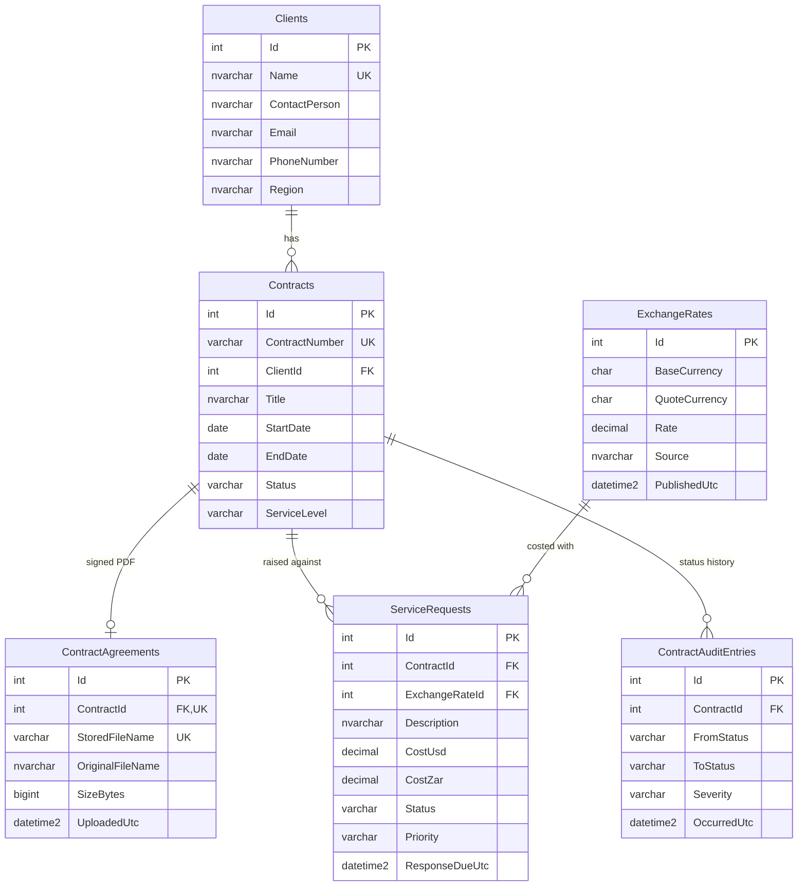

# Global Logistics Management System (GLMS) – Part 2

**TechMove Logistics · Core Prototype & Unit Testing**
Nobesuthu Gongo · ST10545758

ASP.NET Core MVC (.NET 8) prototype of the GLMS designed in Part 1. It implements the
Contract Management Hub, Service Request Processing with a live USD → ZAR currency API,
PDF signed-agreement uploads, and the three GoF patterns from the Part 1 UML
(**Strategy**, **Observer**, **Factory Method**), backed by SQL Server through Entity Framework Core
and an xUnit test project.

---

## 1. Solution structure

```
GLMS.sln
├── src/GLMS.Core      Domain model, business rules, the 3 design patterns (no web/EF dependencies)
├── src/GLMS.Web       ASP.NET Core MVC: controllers, Razor views, EF Core DbContext + repositories
└── tests/GLMS.Tests   xUnit + Moq test project
```

Although Part 2 is a monolith (one deployable web app), the business logic sits in its own
class library. That is what makes it unit-testable, and in Part 3 the same `GLMS.Core` can be
reused unchanged behind a Web API in Docker containers.

| Layer | Responsibility | Talks to |
|---|---|---|
| Controllers (`GLMS.Web/Controllers`) | HTTP, view models, ModelState | Services only — **never** the DbContext |
| Services (`GLMS.Core/Services`) | Use cases: create contract, raise request, expire contracts | Repositories, patterns |
| Patterns (`GLMS.Core/Patterns`) | Strategy / Observer / Factory Method | Domain |
| Repositories (`GLMS.Web/Data`) | EF Core queries, `SaveChangesAsync` | `GlmsDbContext` |

## 2. Getting it running (Visual Studio 2022)

**Prerequisites:** Visual Studio 2022 (17.8+) with the *ASP.NET and web development* workload
(includes .NET 8 SDK and SQL Server LocalDB).

1. Open `GLMS.sln`. Visual Studio restores the NuGet packages automatically.
2. **Create the database migration** (one time). Open
   *Tools → NuGet Package Manager → Package Manager Console*, set **Default project** to
   `GLMS.Web`, then run:
   ```powershell
   Add-Migration InitialCreate
   Update-Database
   ```
   (CLI alternative: `dotnet tool install --global dotnet-ef` then
   `dotnet ef migrations add InitialCreate --project src/GLMS.Web` and
   `dotnet ef database update --project src/GLMS.Web`.)
3. Set `GLMS.Web` as the startup project and press **F5**.

On first start the app applies migrations and seeds demo data (4 clients, 6 contracts covering
every status, 2 service requests, and real sample PDFs for the signed agreements).

The connection string is in `src/GLMS.Web/appsettings.json` (`ConnectionStrings:GlmsDatabase`) —
it is never hard-coded. If you use a full SQL Server instance instead of LocalDB, change it there.

### Database migration script (submission requirement)

After `Add-Migration InitialCreate`, generate the SQL script with:

```powershell
Script-Migration -Output Database/GLMS_InitialCreate.sql
```

Commit both the `Migrations/` folder and `Database/GLMS_InitialCreate.sql`.

## 3. Running the tests

* Visual Studio: *Test → Test Explorer → Run All*. Take the screenshot of all tests green for the submission.
* CLI: `dotnet test`
* GitHub Actions: `.github/workflows/dotnet-tests.yml` builds the solution and runs every test
  automatically on each push (see the **Actions** tab on GitHub).

**294 test cases** across 24 test classes:

| Area | Test class | What is proven |
|---|---|---|
| Currency maths | `CurrencyCalculatorTests` | USD→ZAR maths for given rates, rounding to cents (half away from zero), decimal precision, zero, negative amount, zero/negative rate, invalid currency codes |
| Strategy | `FinancialServiceTests` | Context uses the strategy's rate, `SetStrategy` swaps provider at runtime, identity conversion skips the API, failures surface correctly |
| External API | `LiveRateApiStrategyTests` | JSON parsing via a fake `HttpMessageHandler`; HTTP 500/503/429/404, network down, timeout, malformed JSON, missing ZAR, zero rate |
| Caching / availability | `CachedRateStrategyTests` | TTL caching, refresh after expiry, falls back to last known rate when the API is down |
| File validation | `FileValidatorTests` | `.exe` and other types rejected, `agreement.pdf.exe` trick, empty file, 10 MB boundary, `.exe` renamed to `.pdf` (content check) |
| File server | `LocalFileStorageServiceTests` | Saved to disk under GUID name, no overwrites, rejected files never written, path-traversal blocked |
| Workflow | `ContractWorkflowTests` | Every allowed/illegal status transition, activation needs a signed PDF, Observer notifications |
| Business rule | `ServiceRequestValidatorTests` | Requests blocked on Expired / On Hold / Draft / out-of-term contracts; cost and description edge cases; observer holds/cancels/resumes requests |
| Audit | `ComplianceLoggerTests` | Audit entry with correct severity per status change |
| Factory Method | `ServiceRequestFactoryTests` | SLA tier rules (48h / 8h / 2h), factory can't bypass validation, resolver picks the right factory |
| LINQ search | `ContractSearchTests` | Date-range overlap (inclusive boundaries), status, client, SLA, case-insensitive keyword, invalid range |
| Use cases (Moq) | `ServiceRequestServiceTests` | Expired/On Hold → nothing saved **and no API call made**; API down → nothing saved |
| Home to-do and term | `WorkQueueTests` | To-do list urgency order (overdue request, due within 24h, unsigned draft, on hold, ending within 30 days), request summary counts, contract term progress and days left |
| Contract timeline | `ContractMilestonesTests` | Reached / to-do / upcoming milestones built from the audit trail, in date order, for draft, active, on-hold and expired contracts |
| Robustness | `FixedRateStrategyTests`, `RatePrecisionTests`, `ContractValidatorTests`, `ClientValidatorTests`, `ConcurrencyTests`, `CompletePdfTests` | Third strategy plugs in unchanged, rates rounded to stored precision, every validator edge case (limits, 10-year term, leap years, tampered status), two-people-editing conflict, truncated PDFs rejected |
| Normalisation rules | `NormalisationRulesTests` | One agreement record per contract (replaced in place), one record per published rate shared by every request costed with it, unique client names, email rule matching the database constraint |
| Use cases | `ContractServiceTests`, `ClientServiceTests`, `ServiceRequestEntityTests` | Contract create/upload/download, automatic expiry, full create → hold → blocked → reactivate flow |

## 4. Where each requirement is implemented

| Requirement | Implementation |
|---|---|
| SQL Server + EF Core | `Data/GlmsDbContext.cs`, configured entirely with the Fluent API. See **Database design** below |
| Entities | `Client` (Name, Contact details, Region), `Contract` (Client, StartDate, EndDate, Status, ServiceLevel), `ServiceRequest` (Contract, Description, Cost USD/ZAR, Status), plus `ContractAuditEntry` |
| PDF upload / download | `LocalFileStorageService` saves to `App_Data/agreements` (outside `wwwroot`) as `{GUID}.pdf`, so files are never overwritten, and only the file name goes in the database. Strict checks: `.pdf` extension (blocks `x.pdf.exe`), not empty, 10 MB or less, `%PDF-` header and `%%EOF` end marker (blocks renamed `.exe` files and truncated uploads), and path-traversal-proof names. Download streams the file with `nosniff` and `no-store` headers |
| Status workflow and validation | Rules live in GLMS.Core, never in controllers: `ContractValidator`, `ClientValidator` and `ServiceRequestValidator`, plus the workflow in `Contract.ChangeStatus`. No requests on Expired, On Hold or Draft contracts. The browser checks the same rules first with custom attributes (`DateAfter`, `MaxDecimalPlaces`, `PdfFile`, `RequiredIfTrue`) wired into jQuery Validation. Optimistic concurrency (SQL `rowversion`) stops two people overwriting each other, and database errors become readable messages |
| Automated status tracking | `ContractExpiryWorker` (BackgroundService) expires contracts past their end date every hour |
| LINQ search/filter | `ContractQueryExtensions.ApplySearch` – date range, status, SLA, client, keyword |
| Currency API | `LiveRateApiStrategy` calls ExchangeRate-API (`https://open.er-api.com/v6/latest/USD`) with `HttpClient` and async/await, through a typed client from `IHttpClientFactory` with a timeout. One automatic retry covers network blips and 5xx errors (never on 4xx or 429). try/catch turns every failure into a clear message, and the cache falls back to the last known rate for up to 24 hours, then stops rather than guessing. Maths uses `decimal` throughout: rates are rounded to the stored 6 decimal places before use, and costs are rounded half away from zero to the cent. The live browser preview uses exact integer (BigInt) maths and matches the server on 20,000 random cases |
| Async/await | Every controller action, service, repository and the API call are async; no `.Result` / `.Wait()` anywhere |
| Client + server validation | DataAnnotations + jQuery unobtrusive validation and a JS PDF check in the browser; authoritative rules re-checked in `GLMS.Core` |

## 5. Database design

Six tables, normalised to third normal form (3NF): every column depends on the key of its own table and on nothing else.



**Normalisation decisions**
* **Signed agreements have their own table** (`ContractAgreements`, at most one row per contract). File name, original name, size and upload time describe the document, not the contract. Keeping them out of `Contracts` also avoids four empty columns on every draft.
* **Exchange rates have their own table.** Rate, source and publish time describe a published rate, not a request. Each rate is stored once (unique on currency pair + publish time + rate), and every request costed with it references that row.
* **Atomic values.** Region is a single value ("Southern Africa"), and there are no lists or combined fields.
* **One deliberate derived column:** `ServiceRequests.CostZar` (= CostUsd x rate). The brief requires the local cost to be saved, it records what was actually quoted, and it is calculated in one tested place (`CurrencyCalculator`).
* `ContractAuditEntries.Message` is an immutable log line, kept as written at the time.

**Constraints (all Fluent API, no attributes on the domain classes)**
* Primary keys on every table. Foreign keys with `Restrict` on financial and legal records (clients, contracts, requests, rates) and `Cascade` only for agreements and audit entries, which belong to their contract.
* Unique indexes: `Clients.Name`, `Contracts.ContractNumber`, `ContractAgreements.ContractId`, `ContractAgreements.StoredFileName`, and the exchange-rate natural key.
* CHECK constraints:
  * Status columns only accept real status names (`CK_Contracts_Status`, `CK_ServiceRequests_Status` and others).
  * `EndDate > StartDate`, `CostUsd > 0`, `CostZar >= 0`, `Rate > 0`, and base and quote currencies must differ.
  * Response due and closed times can't be before the created time.
  * Agreements must be `.pdf` and at most 10 MB.
  * Client names can't be blank, and emails must look like `name@domain.tld`.
* Data types and lengths: money is `decimal(18,2)`, rates are `decimal(18,6)`, currency codes are fixed-length `char(3)`, dates are `date`, and timestamps are `datetime2(0)`. Every text column has a maximum length.
* The connection string is only in `appsettings.json` (`ConnectionStrings:GlmsDatabase`). It is never in code.

The application enforces the same rules before saving (for example a duplicate client name or `a@b` gets a clear message on the form), so the database constraints are a final safety net, not the first line of validation.

## 6. User interface

The UI is modelled on real freight platforms rather than a generic admin template:

* **Home is a to-do list** (like Flexport's action checklist): overdue service requests, requests due within 24 hours, contracts waiting for a signed PDF or activation, contracts on hold and contracts ending within 30 days, most urgent first. Built by `WorkQueue` in GLMS.Core.
* **Each contract's term is drawn like a shipping route**: start and end pins with a marker for today, plus days left.
* **The contract page has a milestone timeline** (like Shypple and Wakeo shipment timelines): Drafted, Signed, Activated, holds, open work and expiry, each marked reached, to-do or upcoming. Built by `ContractMilestones` from the compliance audit trail.
* Global search in the top bar, sentence-case labels and two typefaces (Archivo for headings, Source Sans 3 for text), following Maersk's design-system guidance.

## 7. Design patterns (from the Part 1 UML)

| Pattern | Classes | Problem solved |
|---|---|---|
| **Strategy** | `ICurrencyConversionStrategy` ← `LiveRateApiStrategy`, `CachedRateStrategy`, `FixedRateStrategy`; Context: `FinancialService` (`SetStrategy`). The provider is chosen in `appsettings.json` (`CurrencyApi:Mode` = `Live` or `Fixed`) with no code change | Exchange-rate provider can change without touching financial logic; cached strategy keeps working if the API is down |
| **Observer** | Subject: `Contract` (`Subscribe`, `ChangeStatus`); `IContractObserver` ← `ServiceRequestValidator`, `ComplianceLogger` | A status change automatically holds/cancels/resumes open requests and writes the compliance audit trail, without `Contract` knowing those classes |
| **Factory Method** | `ServiceRequestFactory` (abstract `CreateRequest`) ← `StandardSLAFactory`, `PriorityLogisticsFactory`; `ServiceRequestFactoryResolver` | Each SLA tier builds requests with its own priority and response window; validation can never be skipped |

All three are registered in `Program.cs` with dependency injection.

**Small refinements to the Part 1 UML** (worth mentioning in the video):
* `ICurrencyConversionStrategy.Convert(...)` became `GetRateAsync(...)` returning a quote, because an HTTP call must be asynchronous (LU4), and the multiplication moved to `CurrencyCalculator` so it can be tested with an exact rate.
* `CreateRequest(contract)` also receives the user input and the currency conversion, so the factory builds a complete request in one step.
* `FinancialService.ProcessInvoice()` is out of scope for this prototype (no invoicing module yet).

## 8. Video demo script (suggested order)

1. **Solution tour** (1–2 min): the three projects; why Core is separate; `Program.cs` DI registrations for the 3 patterns.
2. **Database:** the ER diagram in this README, `GlmsDbContext` (Fluent API keys, relationships, unique indexes and CHECK constraints), the `appsettings.json` connection string, the tables and keys in SQL Server Object Explorer, and the migration and its script. Explain why agreements and exchange rates have their own tables.
3. **Home:** the to-do list (most urgent first), contract term lines and the live USD→ZAR rate with the quick converter.
4. **Automatic expiry:** contract *TM-2026-D4006* was seeded Active but past its end date – show it is now Expired, with a *Critical* entry in its audit trail.
5. **Contracts:** search by date range + status. Create a contract as Draft → try to Activate (blocked: no PDF) → try uploading an `.exe` (rejected) → upload a PDF → Activate → download the PDF. Show the file in `App_Data/agreements` with its GUID name.
6. **Service request:** pick a contract, type a USD amount and watch the ZAR preview; submit and show the saved rate and ZAR cost. Show urgent escalation on a Priority Logistics contract (2-hour response).
7. **Business rule:** put the contract *On Hold* → its open request goes On Hold, the contract disappears from the request dropdown, and the details page explains why. Re-activate → request resumes. Expired contract *TM-2025-C3003* cannot receive requests.
8. **Code walkthrough:** `Contract.ChangeStatus` (Observer), `ServiceRequestFactory.CreateRequest` (Factory Method), `FinancialService` + `CachedRateStrategy` (Strategy, try/catch fallback).
9. **Tests:** Test Explorer – all green; open `ServiceRequestServiceTests` (Moq verifies nothing was saved and no API call was made for an expired contract) and `FileValidatorTests` (.exe). Then the green GitHub Actions run.

## 9. Pushing to GitHub

```bash
git init
git add .
git commit -m "GLMS Part 2: MVC prototype, EF Core, design patterns, xUnit tests"
git branch -M main
git remote add origin https://github.com/<your-username>/GLMS.git
git push -u origin main
```

Uploaded PDFs (`App_Data/`) and build output are excluded by `.gitignore`.

---
Exchange rates: [Rates By Exchange Rate API](https://www.exchangerate-api.com) (free open-access endpoint, refreshed daily; cached for 60 minutes in line with the provider's rate-limit guidance).
